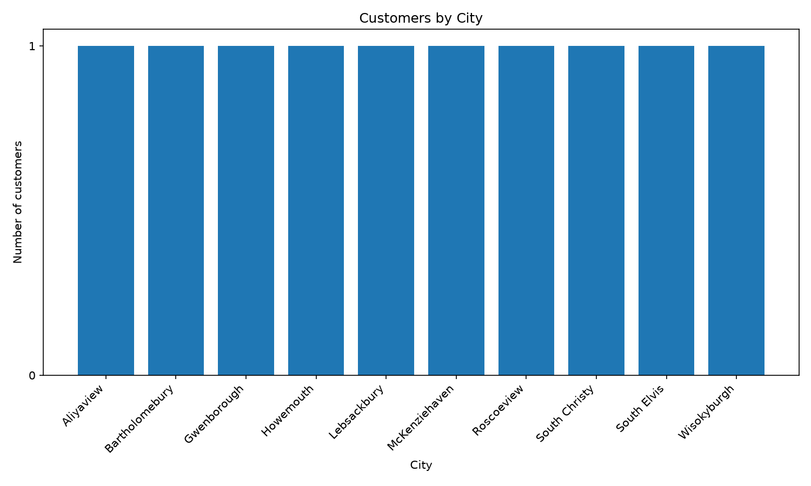
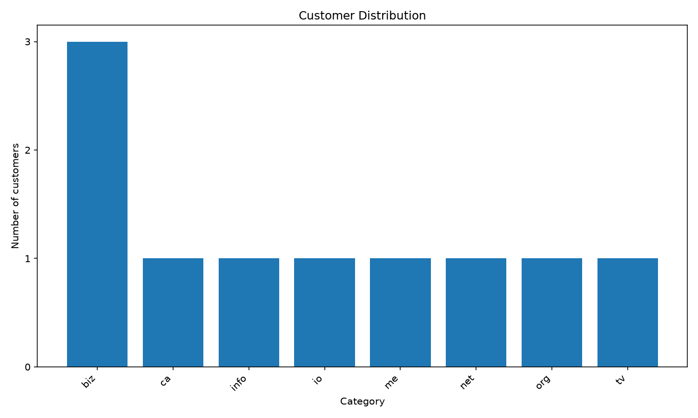

# Api Analysis

Pulls a customer list from an API, looks at how the data is structured, and answers one question for Pesa Pulse's marketing team: where are our customers?

## How I approached it

1. Fetched 10 customers from the JSONPlaceholder API with `requests`. A timeout, a status check and clear error messages mean a failed request prints a message instead of a traceback.
2. Explored one record with a recursive function that prints every key and its type.
3. Flattened each customer into 12 fields: ID, name, username, email, email domain, phone, city, zipcode, latitude, longitude, company and website.
4. Used a set to find unique cities, then counted customers per city and per email domain with plain Python, without `Counter` or pandas.
5. Moved the data into pandas and checked that its counts match mine.
6. Exported the results to CSV and drew bar charts.

## How to run it

```
python -m venv .venv
.venv\Scripts\activate
pip install -r requirements.txt
python analysis.py
```

Results are saved in the `output/` folder:
- `customers.csv`: one row per customer
- `city_counts.csv`: customers per city
- `customer_distribution.png`: customers by city
- `email_domain_distribution.png`: customers by email domain

## What the data looks like

Two attributes are nested: `address` (which contains another nested object, `geo`) and `company`. The deepest values are the coordinates, reached with `customer["address"]["geo"]["lat"]` (and `["lng"]`). The API stores them as strings (in quotes), so I convert them to floats.

## Findings

- **There are 10 customers in 10 different cities.** No city has more than one customer, so city-level campaigns would each reach one person. Marketing needs a broader grouping, such as region or country.
- **The email domain chart is more useful than the city chart.** The city chart is 10 equal bars and shows nothing, while the email domain chart shows `biz` is the most common, with 3 customers. The other 7 each have a different domain.

## Charts




## Assumptions

- The email domain is the part after the last dot (`Sincere@april.biz` becomes `biz`), since the API doesn't provide it directly.
- With only 10 records, I treated the API data as complete and did not clean or drop anything.
